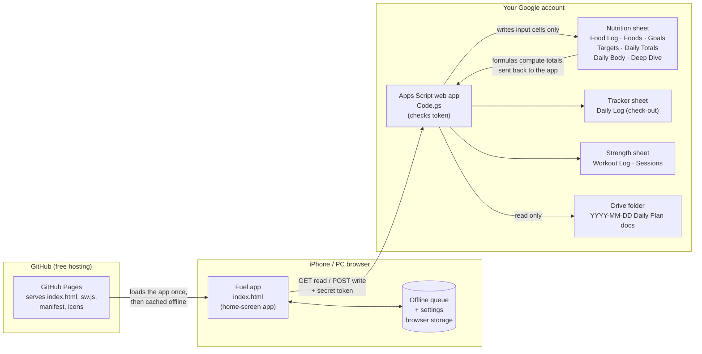

# How Pillars Fuel Works (and How to Build Your Own)

A personal food, workout and daily check-out app that runs on an iPhone and a PC. Your own Google Sheets hold all the data, there's no paid service and no app store, and you control every line of code.

This guide uses Pillars Fuel as the worked example. Anything private (sheet IDs, the token, the web address of the backend, personal names) is shown as a **placeholder** like `<YOUR_SHEET_ID>`.

---

## 1. The big picture

Three pieces, each doing one job:

| Piece | Lives on | Job | Cost |
|---|---|---|---|
| **The app** (what you tap) | GitHub Pages | Screens, buttons, charts, offline queue | Free |
| **The backend** (the messenger) | Google Apps Script | Checks a secret token, then reads/writes specific sheet cells | Free |
| **The data** (the source of truth) | Google Sheets + Drive | Stores every entry; formulas do all the math | Free (your Google storage) |



**The key idea:** the app never does the bookkeeping. It writes a few plain input cells (date, food, amount, unit). The sheet's own formulas do the nutrition math, and the app reads the results back. If the app disappeared tomorrow, every number would still be in your spreadsheet, readable and correct.

---

## 2. The pieces in detail

### 2a. The app (front end)

- **`index.html`:** the entire app in one file (layout, styles and code). No build step and no frameworks.
- **`sw.js`:** a *service worker*. It saves a copy of the app on the phone so it opens instantly and works offline. It always tries the network first, so updates show up on the next open.
- **`manifest.webmanifest` + icons:** these let Safari's **Add to Home Screen** make it look and launch like a real app.
- **Browser storage on the phone holds:**
  - the backend address and token (typed in once in Settings)
  - an **offline queue** of changes not yet saved
  - a cached copy of each day, so screens show instantly
- **Demo mode:** with no address or token entered, the app runs on built-in sample data. That's handy for trying it out or sharing.

### 2b. The backend (Google Apps Script)

**`Code.gs`** is a small script that lives in your Google account and is published as a **web app** with its own address (ending in `/exec`). The app talks to it in two ways:

| Call | Action | What it does |
|---|---|---|
| GET | `bootstrap` | First load: foods list, goals, targets, Deep Dive data, and the day's entries |
| GET | `day` | One day: entries, body stats, check-out, 30-day history |
| GET | `plan` | That date's Daily Plan doc (read only) |
| POST | `addFood` / `removeFood` | Add or clear one Food Log row |
| POST | `saveBody` | Weight, steps, water, exercise, note |
| POST | `saveCheckout` | Evening check-out fields in the tracker |
| POST | `addSets` | Workout sets plus a session row |
| POST | `batch` | Up to 20 of the above in one trip (used by the offline queue) |

**`appsscript.json`** sets three things:
- **Time zone:** must match your sheets.
- **Permissions:** spreadsheets, read-only Drive, and outside requests (used to export the Daily Plan doc as text).
- **Web app settings:** "execute as me," and access set to "anyone."

### 2c. The data (Google Sheets + Drive)

Three spreadsheets and a folder. Column letters matter, because the backend writes by position.

| Sheet → tab | Columns the app **writes** | Columns that are **formulas** (never written) |
|---|---|---|
| Nutrition → **Food Log** | A Date · B Food · C Amount · D Unit · AK Note (`@08:00 app #L…`) | E–AJ: nutrients per entry (`ARRAYFORMULA` lookup from Foods) |
| Nutrition → **Foods** | (you edit by hand) A Name · B Category · C Serving · D Grams per serving · E–AI 31 nutrients per 100 g | — |
| Nutrition → **Goals / Targets** | (you edit by hand) daily calories, protein, fat, carb max, weight goal; vitamin and mineral targets | — |
| Nutrition → **Daily Totals** | (read only) | Whole tab: daily sums the charts read |
| Nutrition → **Daily Body** | A Date · B Weight · D Steps · E Water · F Exercise · G Note | **C** 7-day average · **H** Training min (pulled from the Strength sheet) |
| Tracker → **Daily Log** | Check-out columns, matched **by header name**; meal columns only if empty | Everything else |
| Strength → **Workout Log** | A–K, one row per set; Notes end with `#W…` | L–N |
| Strength → **Sessions** | A–D, one row per workout day | E–G |
| Drive → **Daily folder** | (read only) docs named `YYYY-MM-DD Daily Plan` | — |

---

## 3. What happens when you tap

**Opening the app**
1. The phone loads the saved copy of the app. It's instant, even offline.
2. The app asks the backend for the day (`bootstrap` once an hour, otherwise `day`).
3. The backend reads the sheets and sends back entries plus formula results. The app draws the rings and charts.

**Logging a food (e.g. 4 eggs)**
1. The app adds the entry on screen right away and gives it a unique ID (`L…`).
2. The change goes into the **offline queue** in phone storage.
3. The queue sends up to 20 waiting changes in **one** request.
4. The backend checks the token, takes a lock (so two saves can't collide), and checks whether that ID is already in the Food Log. If it is, it doesn't add it again (retry protection). If not, it appends A–D plus the AK note.
5. The sheet's formulas fill in E–AJ (calories, protein, vitamins…).
6. On the next load, the app reads those totals back.

**No signal (train, basement):** changes wait in the queue with a "3 waiting" sync bar. They send automatically when the connection returns or the app is reopened.

**Evening check-out:** only the fields you actually touched are sent. Meal summaries go into Breakfast, Lunch, Dinner and Snacks only if those cells are empty, so nothing you typed elsewhere gets overwritten.

**Workout:** each session gets an ID (`W…`). Saving again **replaces** that session's rows instead of duplicating them.

**Daily Plan card:** the backend finds that date's doc in the Drive folder, skips anything in the trash, and exports it as text. The app shows the Itinerary, Squeeze-ins, Walks/Weather and Journal sections. In this setup, a separate scheduled Claude task writes those docs each morning, but any doc with the right name works.

---

## 4. The rules that keep the data safe

These are the lessons learned. Keep them if you change anything.

1. **The app writes input cells only. Formulas do the math.** Never let code write into a formula column. Typing even a `0` below a column-filling formula breaks the whole column with `#REF!` (it happened once; see v6.1.4 in the changelog).
2. **Every write has an ID.** Phones lose replies, and retries happen. Tag each row (`#L…`, `#W…`) so the backend can recognize a repeat.
3. **Never delete rows; clear input cells.** Row 2 often holds the formulas.
4. **Match columns by header name where possible** (the check-out does). Position-based tabs are documented above; don't rearrange them.
5. **Don't overwrite what a person typed.** Meal columns are fill-only-if-empty, and check-out sends only touched fields.
6. **Every write is a list of allowed actions.** The backend can't run arbitrary commands, only the eight actions in the table in section 2b.

---

## 5. Security model (plain English)

- **The data never leaves your Google account.** GitHub only hosts the app's code, which contains no data, no token and no backend address.
- **The backend address plus a secret token is the "key."** The web app is set to "anyone can call," then rejects every request without the right token. That's fine for a personal app, but it's a shared secret, not a Google sign-in:
  - Don't share screenshots of Settings with the token filled in.
  - If it leaks, run `setToken()` in Apps Script and paste the new token into the app.
- **Old deployments stay live.** Each **New deployment** creates a new address that keeps running its old code. Archive old ones under **Deploy → Manage deployments**.
- **What a token holder could do:** read the data the app reads (food, body, check-out, plan docs), and write only the specific cells listed in section 2c. They can't run their own code or open your other files.

---

## 6. Build your own (about 1 hour)

You need a Google account, a free GitHub account and an iPhone or any browser. No coding experience is needed: everything is copy-paste.

**Step 1: Sheets (20 min)**
1. Create three Google Sheets (or one with all the tabs) using the tab and column layout in section 2c.
2. In **Foods**, add your foods: name, category, serving, grams per serving, then nutrients per 100 g (the USDA FoodData Central database is a good source).
3. In **Food Log** row 2, add `ARRAYFORMULA` lookups that multiply each entry's grams by the Foods values. **Daily Totals** sums by date.
4. Set every sheet's time zone (**File → Settings**) to the same zone as the script.
5. Copy each sheet's ID from its address bar: `docs.google.com/spreadsheets/d/<THIS_PART>/edit`.

**Step 2: Backend (10 min)**
1. Go to **script.google.com → New project**.
2. Paste `apps-script/Code.gs` and replace the IDs at the top with yours:
   ```
   const NUTRITION_ID = '<YOUR_NUTRITION_SHEET_ID>';
   const TRACKER_ID   = '<YOUR_TRACKER_SHEET_ID>';
   const STRENGTH_ID  = '<YOUR_STRENGTH_SHEET_ID>';
   const DAILY_FOLDER = '<YOUR_DRIVE_FOLDER_ID>';
   const TZ           = '<Your/Timezone>';
   ```
3. Edit `CHECKOUT_FIELDS` to match your own check-out column headers.
4. **Project Settings → Show "appsscript.json"**, paste `apps-script/appsscript.json`, and match the time zone.
5. Pick `setToken` from the function list → **Run** → approve the permissions → copy the token from the **Execution log**.
6. **Deploy → New deployment → Web app.** Execute as: **Me**. Access: **Anyone**. Copy the `/exec` address.

**Step 3: App hosting (10 min)**
1. Create a GitHub repo and upload `index.html`, `sw.js`, `manifest.webmanifest` and the two icons.
2. **Settings → Pages →** deploy from branch `main`, root folder.
3. Your app address is `https://<your-github-name>.github.io/<repo-name>/`.
4. Edit the quick-food buttons (`CHIPS` in `index.html`) so their names exactly match your Foods tab.

**Step 4: Phone (5 min)**
1. Open the app address in **Safari** → **Share → Add to Home Screen**.
2. Open it → **Check-out → Settings** → paste the `/exec` address and token → **Save & connect**.
3. Run the phone checklist in `TESTING.md`.

---

## 7. Updating it later

| You changed… | Do this | App settings change? |
|---|---|---|
| `index.html` / `sw.js` | Push to GitHub. Pages updates in about 1 minute. Reopen the app twice. | No |
| `Code.gs` | Paste into Apps Script → **Deploy → Manage deployments → Edit (pencil) → New version → Deploy** | **No** (same address and token) |
| You chose **New deployment** instead | You get a new `/exec` address and must paste it into Settings. Archive the old one. | Yes |
| You ran `setToken()` | New token; paste it into Settings. | Yes |
| Foods, Goals, Targets in the sheet | Nothing. The app refreshes within an hour, or tap **Refresh** in Settings. | No |

Before pushing any code change, run the automated tests (`node tests/run.js`, see `TESTING.md`), and record the release in `CHANGELOG.md`.

---

## 8. File map

| File | What it is |
|---|---|
| `index.html` | The whole app |
| `sw.js` | Offline copy and fast startup |
| `manifest.webmanifest`, `icon-*.png` | Home-screen install |
| `apps-script/Code.gs`, `apps-script/appsscript.json` | Backend, working copy (the tests run against it) |
| `code.gs`, `appsscript.json` (repo root) | Owner's copy of what's actually deployed |
| `tests/` | Automated end-to-end tests (real app plus real backend on mock sheets) |
| `SETUP.md` | Original install notes for this specific setup |
| `TESTING.md` | Automated tests plus a 10-minute phone checklist |
| `CHANGELOG.md` | Version history and deploy log |
| `HOW-IT-WORKS.md` | This file |

---

## 9. How it was built

Fernando designed it (what to track, how it should look and behave) and built it with Claude through Claude Code over a few sessions. The process:
- Described what he wanted, often with screenshots of the app it replaced.
- Reviewed each version on his phone.
- Asked for changes, and had the code reviewed line by line.

The work was done in small, versioned steps, each tested before it shipped (see `CHANGELOG.md`). A self-described "script kitty" can maintain it: every change is a copy-paste plus a redeploy, and the rules in section 4 keep the data safe.
